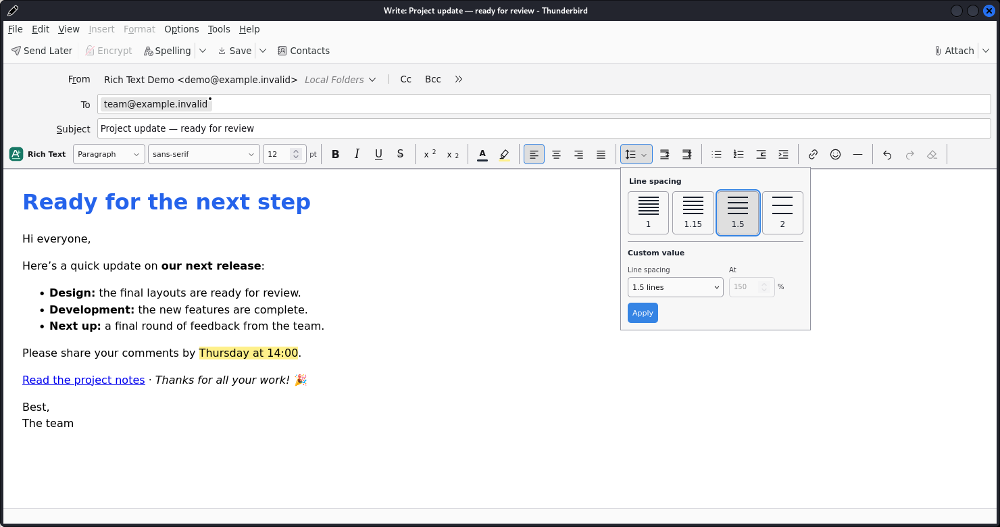

# thunderbird-rich-text

[](https://github.com/albilu/thunderbird-rich-text/actions/workflows/release.yml)
[](https://github.com/albilu/thunderbird-rich-text/releases/latest)
[]()

**A persistent rich-text formatting toolbar above the message body in
Thunderbird's own composer — fonts, sizes, colors, highlights, lists, links,
and emoji.**

A dependency-free Thunderbird MailExtension plus a small Experiment API. It
does not replace the editor, and all formatting happens locally.



## Why?

Thunderbird's built-in formatting toolbar is minimal: no custom fonts or point
sizes, no highlight color, no searchable emoji, no paragraph spacing.
**thunderbird-rich-text** adds those tools to the existing editor while
Thunderbird keeps handling typing, spell checking, signatures, drafts, and
sending.

## Features

- **Fonts and sizes** — searchable dropdown of all installed families (custom
  names accepted) and numeric point sizes, including decimals like 10.5 pt.
- **Paragraph styles and spacing** — paragraph, three heading levels, quote,
  preformatted; LibreOffice-style line-spacing presets plus direct
  increase/decrease paragraph-spacing buttons.
- **Inline formatting** — bold, italic, underline, strikethrough,
  superscript, subscript, clear formatting, native undo/redo.
- **Layout** — left/center/right/justify, numbered and bulleted lists,
  indentation, horizontal dividers.
- **Colors** — text and background/highlight with preset palettes and custom
  hex.
- **Links and emoji** — add/edit/remove web, mailto, and tel links; searchable
  emoji with locally stored recents; emoji also work in plain-text compose.
- **Native look and feel** — follows Thunderbird's light/dark theme, labeled
  controls, keyboard navigation, live formatting state at the caret.
- **English and French** — automatically follows Thunderbird’s interface language,
  with translated controls, settings, messages, and searchable emoji keywords.
  Other languages fall back to English.
- **Toolbar settings** — hide Thunderbird's original toolbar (default) or show
  both; choices persist across restarts and upgrades.

Formatting runs through a validated compose-script bridge using Gecko's native
editing transactions, so every operation integrates with Thunderbird's undo
history. No remote editor, account, or service is involved.


<details>
<summary><strong>Requirements</strong></summary>

- **Thunderbird 128–153.x** — verified on Thunderbird **153.4.0 ESR, Linux**;
  other versions should be verified before publishing.
- The Experiment API requires Thunderbird's **full, unrestricted access**
  permission prompt on install and upgrade.
- Build from source needs **Node.js 20+** and **Python 3.9+**; no npm or pip
  packages to install.

</details>

## Install

Download `thunderbird-rich-text-<version>.xpi` from the
[Releases page](https://github.com/albilu/thunderbird-rich-text/releases/latest).

In Thunderbird, open **Add-ons and Themes → gear menu → Install Add-on From
File…** and select the `.xpi`. Open a Write, Reply, or Forward window — the
toolbar sits above the message body.

Select text, then use the toolbar: inline tools apply to the selection,
paragraph tools to the current paragraph, and emoji/links insert at the
cursor. Configure toolbars under **Add-ons and Themes → Thunderbird Rich Text
→ Preferences**.


## Development

For quick iteration, use **Tools → Developer Tools → Debug Add-ons → Load
Temporary Add-on…** with `extension/manifest.json`, and reload after edits.

```sh
npm run build               # check + test + package XPI into dist/
npm run check               # syntax, manifest, resource, permission checks
npm test                    # unit tests (command safety, routing, reproducible XPI)
npm run test:thunderbird    # real Thunderbird suite (Linux; needs Xvfb + xfwm4)
RICH_TEXT_TEST_LOCALE=fr npm run test:thunderbird # French interface and formatting
python3 scripts/package.py  # package only, no checks
```

The native suite runs a disposable offline profile, never touches your real
profile or sends mail, and is not part of CI. Releases are tagged `v<version>`
matching `extension/manifest.json`; GitHub Actions builds and publishes the
XPI from `.github/workflows/release.yml`.

Translations live in `extension/_locales/<language>/messages.json`, with `en` as
the fallback. Keep the same message keys and named placeholders in each catalog.
The build checks translation coverage and placeholders; see the
[verification checklist](docs/testing.md) for native language tests.

More details: [design notes](docs/design.md),
[verification checklist](docs/testing.md),
[privacy statement](docs/privacy.md).
